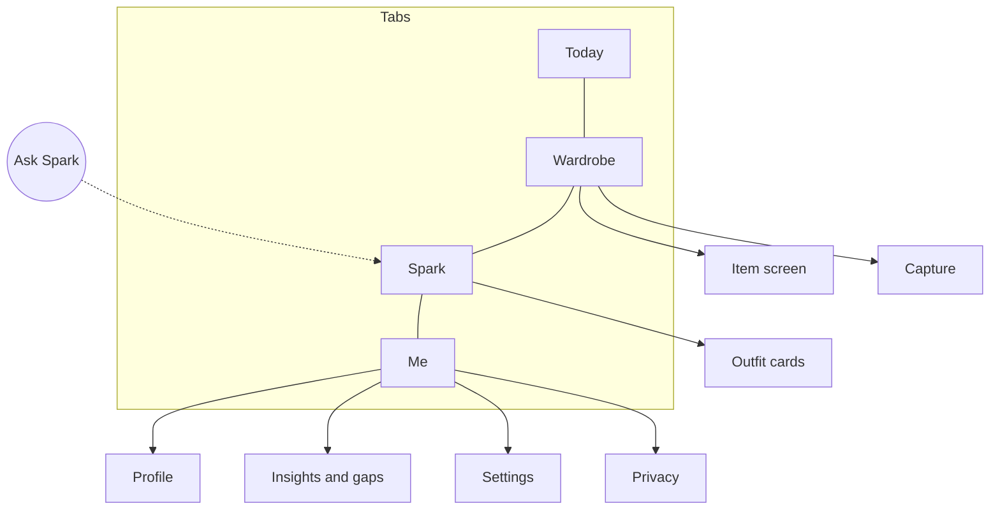
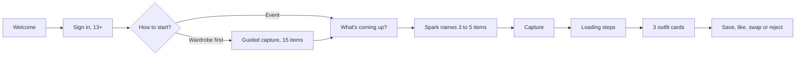
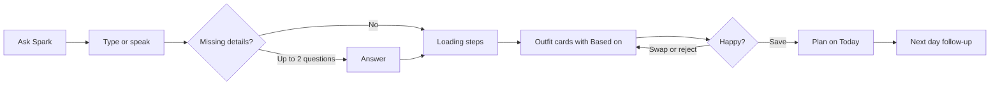
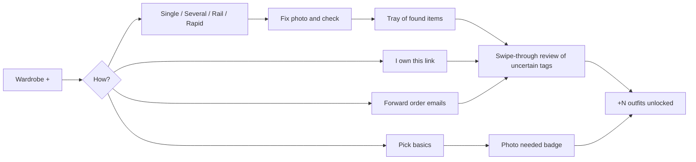

# Wear Today Phase 1: UX decisions

Date: 20/11/2026. Decisions Q134 to Q153 from the UX brainstorm. Builds on the [Phase 1 PRD](../../prds/wear-today.md), Spark's [persona](../persona.md) and [SAFEGUARDS.md](../../SAFEGUARDS.md). Prototype screenshots will be added here.

## Principles

- The user's own clothes are the hero.
- One-handed: main actions in the bottom half of the screen.
- Quiet by default: show only what is relevant now.
- Spark explains, never hides: reasons and "Based on:" on every suggestion.
- Every "no" leaves a way to carry on.

## Structure (Q134)

Four bottom tabs plus a floating **Ask Spark** button on every screen.

| Tab | Holds |
|---|---|
| **Today** | Greeting and weather, today's outfit or saved plans, check-up card, post-event follow-ups, day-suited prompts |
| **Wardrobe** | Item grid, filters, outfits-unlocked total, first-set progress, add items |
| **Spark** | Current conversation and past requests by event |
| **Me** | Profile, insights and gaps, settings, privacy, help and feedback |

## Screens

### First run (Q142)

1. **Welcome**: Spark introduces itself in one line and says it is an AI styling assistant.
2. **Sign in**: date of birth (13+; teen mode for 13 to 17), then passkey or email code, before the first photo so nothing is lost.
3. **Choose how to start**, side by side:
   - "Start with an event: first outfit in about 3 minutes"
   - "Build my wardrobe first: about 10 minutes for 15 items"

No more than 3 screens before the camera opens. Optional profile questions come only after the first outfit.

### Today (Q141)

Top to bottom: greeting and weather ("Morning ☀️ 14°C, showers from 15:00"); today's outfit (if the weather-only daily outfit is on) or saved plans; check-up card when due; post-event follow-up when due; "Ask Spark" prompts suited to the day. At most 3 cards visible without scrolling.

### Asking Spark (Q135)

Text box with example prompts and quick-pick chips (occasion, formality, mood); microphone button beside it. Press and hold to talk, with words shown as you speak. Spoken replies on or off in settings.

### Loading (Q145)

Spark shows the real steps it is taking ("Checking the weather in Bath… picking shoes for grass… putting together 3 outfits"). The first outfit appears as soon as it is ready. No invented steps.

### Outfit cards (Q136, Q150, Q152)

- One large card at a time, swiped sideways, dots showing 1 of 3; "Compare all 3" one tap away.
- Each card: item collage, Spark's one-line reason, the "Based on:" line (each part tappable to correct), and actions: ❤️ like, ✕ reject (with one-tap reasons), swap an item, save.
- **Swap**: tap an item to see a row of alternatives that work with the rest, best first, checked in code; tap to swap; the reason updates; undo available.
- **Gap line** under the relevant card: "Missing: a neutral blazer · +6 outfits". Never a pop-up, never "buy".

### Capture (Q137)

One camera screen, mode switch at the bottom: **Single**, **Several**, **Rail video**, **Rapid**. Live framing outline with simple hints ("move closer", "more light"). Found items appear in a thumbnail tray. Tag review afterwards in a quick swipe-through. Opens in Single the first time, then remembers the last mode.

### Wardrobe (Q143)

Grid of item photos, 3 per row, grouped by category; search bar; filters (category, colour, season, available, needs attention). Header shows the outfits-unlocked total and first-set progress. "+" opens the capture modes and the other ways to add (link, email, basics). **Needs attention** collects uncertain tags, "photo needed" basics and items marked tight, loose or needs altering.

### Item (Q144)

Large photo; editable tags; one row of toggles (fit, favourite, needs ironing and so on); "worn with" and "used in N outfits"; **Build an outfit around this** as the main button; "Mark unavailable". Uncertain tags show a small dot until checked (Q138).

### Spark tab (Q149)

Current conversation; earlier requests listed by event ("Sam's wedding, 14/03/2026"); tap to reopen outfits and the saved choice. Any conversation can be deleted. Chats kept for 12 months (6 months for under-18s) unless saved to a plan.

### Post-event follow-up (Q151)

Today card the next day: "How did the navy dress go at Sam's wedding? 💍" 5 stars, quick-tag chips, "Add a comment" (typed or spoken), "Skip", "Ask me later". Done in under 10 seconds.

### Me (Q148)

Profile (style, fit and colour, with the completion bar); insights and gaps (ranked, each with "Not interested"); settings (reminders, voice, units, notifications); a clearly labelled **Privacy** section (export data, delete account, consents, "what Spark knows about me"); help and feedback.

### Gradual profile questions (Q138)

At most one "Quick question from Spark" card after a suggestion, never during it. "Complete your profile" progress bar on Me. No pop-ups.

## States

### Empty states (Q146)

Each points to the next step, in Spark's voice: empty wardrobe, "Add 3 items for your first outfit 📸"; empty Plans, "Save an outfit to see it here".

### Errors (Q146)

Plain words with the way out, no error codes: "The weather service isn't answering. I'll use typical weather for Bath in March, or try again?"

### Offline (Q146)

Wardrobe and saved plans can be browsed. Asking Spark needs a connection, and the app says so.

### Permissions (Q147)

| Permission | Asked when | If refused |
|---|---|---|
| Camera | First photo | Upload from gallery |
| Location | First request without a place | Type a place |
| Notifications | Reminders or daily outfit switched on | In-app cards only |

Each request is preceded by a one-line reason.

## Visual direction (Q139)

Clean and editorial: plenty of white space, the user's item photos as the hero, one warm accent colour. The full design system follows the prototype.

## Accessibility (Q140)

WCAG 2.2 AA; main actions within one-handed reach; tap targets at least 44 points; respects the phone's text size; screen-reader labels on every item, generated from its tags; no meaning by colour alone; light and dark modes following the phone.

## Main journeys

### First outfit, starting with an event

### Everyday request

### Adding items

## Prototype verdict

**Question:** does the Phase 1 main journey feel right on a phone, and which outfit-results layout works best?

**Answer (20/11/2026):** variant **A**, one outfit card at a time with arrows and dots and "Compare all 3", confirming Q136. Variants B (stacked list) and C (outfits inside the chat) were rejected.

**Prototype (primary source):** branch `prototype/phase-1-journey`, file `prototypes/phase-1-journey/index.html`, also published as a private clickable page. Throwaway code: rebuild properly when implementing; do not merge the branch.

## Decision log

| # | Decision |
|---|---|
| Q134 | Four tabs (Today, Wardrobe, Spark, Me) plus a floating Ask Spark button. |
| Q135 | Text box with prompts and chips; press-and-hold microphone with live words; spoken replies setting. |
| Q136 | One outfit card at a time, swiped, with "Compare all 3". |
| Q137 | One camera screen with Single, Several, Rail video and Rapid modes; framing guide; tray; swipe-through review. |
| Q138 | One quick question card after a suggestion at most; toggle row on items; dot on uncertain tags; profile bar on Me. |
| Q139 | Clean, editorial visual direction; item photos as the hero; one warm accent. |
| Q140 | WCAG 2.2 AA accessibility baseline. |
| Q141 | Today: greeting and weather, outfit or plans, check-up, day prompts; at most 3 cards above the fold. |
| Q142 | Welcome, sign in, choose how to start; 3 screens or fewer before the camera. |
| Q143 | Wardrobe grid with filters, outfits-unlocked total, first-set progress, "Needs attention". |
| Q144 | Item screen with "Build an outfit around this" as the main button. |
| Q145 | Real loading steps from Spark instead of a spinner. |
| Q146 | Empty states point to the next step; plain-word errors with a way out; offline browsing. |
| Q147 | Permissions asked in context with a reason; refusal always leaves a way on. |
| Q148 | Me tab with a clearly labelled Privacy section. |
| Q149 | Spark tab lists past requests by event; deletable; kept 12 months unless saved. |
| Q150 | Swap by tapping an item; valid alternatives only; undo. |
| Q151 | Post-event follow-up card, done in under 10 seconds. |
| Q152 | Gap line under the relevant card; full list in Insights; never "buy". |
| Q153 | UX decisions in `docs/ux/`, linked from the Phase 1 PRD. |
| Q157 | Prototype verdict: results layout A (one card at a time) confirmed. |
